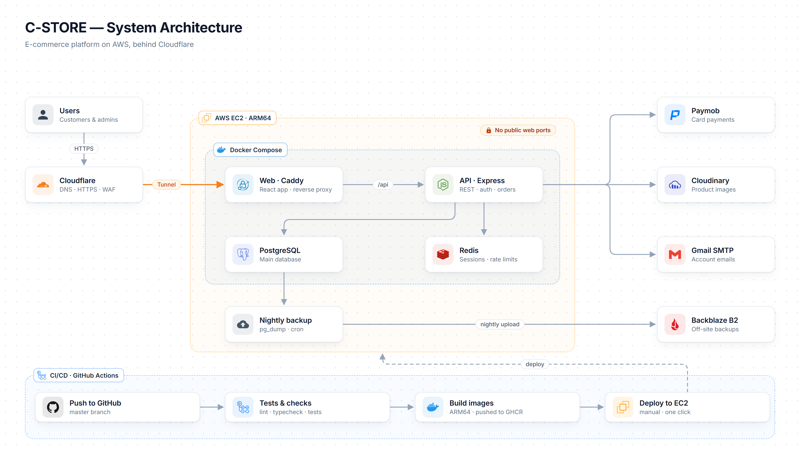

# C-Store

**Live demo: [cstore.ahmedgamal.website](https://cstore.ahmedgamal.website)** — the
[admin dashboard](https://cstore.ahmedgamal.website/admin)

A **production-ready** e-commerce platform for a premium fashion store — full shopping flow (catalog, variants,
cart, checkout, payments, orders) plus an admin dashboard. Built as a TypeScript monorepo with production concerns
baked in: secure auth, concurrency-safe orders, idempotent payments, automated CI/CD, and off-site backups.

---

## Features

- **Catalog with variants** — products → colours → sizes, where each size is the real SKU that carries stock.
- **Cart** — works for guests (local) and logged-in users (persisted), with cart merge on login.
- **Checkout** — cash-on-delivery **and** Paymob card payments; guest and user checkout.
- **Idempotent orders** — an `Idempotency-Key` prevents duplicate orders on double-click or retry.
- **Concurrency-safe inventory** — race-safe stock decrement, stock reservation, and an auto-expiry job.
- **Payments** — Paymob iframe + **HMAC-verified, idempotent** webhook; failed payments restock automatically.
- **Auth** — short access token + **rotating refresh token** (reuse detection), email verification, password reset, RBAC.
- **Admin dashboard** — manage categories, products, variants, stock, and orders; public read-only demo with personal data masked.
- **Image uploads** — product images served via Cloudinary CDN.
- **Hardened** — Helmet, Zod validation, distributed (Redis) rate limiting, nightly off-site DB backups.

---

## Tech stack

| Layer            | Technology                                                                               |
| ---------------- | ---------------------------------------------------------------------------------------- |
| **Frontend**     | React 19, Vite, React Router 7, TanStack Query, React Hook Form, Zod, Tailwind, Radix UI |
| **Backend**      | Node.js, Express 5, TypeScript, Prisma 7, Zod                                            |
| **Data**         | PostgreSQL, Redis                                                                        |
| **Infra**        | AWS EC2, Docker Compose, Caddy, Cloudflare Tunnel, GitHub Actions, GHCR, Backblaze B2    |
| **Integrations** | Paymob (payments), Cloudinary (images), Gmail SMTP (email)                               |
| **Testing**      | Vitest, Supertest                                                                        |

---

## Architecture



C-Store is a **monolith** that runs as Docker containers on an **AWS EC2** (ARM64) server. Traffic reaches it only
through a **Cloudflare Tunnel**, so the server has no public web ports; Cloudflare handles DNS, HTTPS, and the
firewall. Caddy serves the React app and proxies `/api`; the Express API owns the business logic; PostgreSQL is
the source of truth; and Redis holds all ephemeral state (sessions, tokens, idempotency keys, rate-limit counters).

---

### Design pattern — Layered architecture

The backend follows a **layered architecture** with the **repository pattern**:

```
Route  →  Controller  →  Service  →  Repository  →  Database
         (HTTP only)   (business    (data access)
                         logic)
```

- **Controller** — handles HTTP only (reads the request, sends the response).
- **Service** — the business logic and rules.
- **Repository** — the only layer that talks to the database (via Prisma).

---

## Project structure

```
.
├── .github/workflows/ # CI + manual deploy
├── apps/
│   ├── client/        # React + Vite storefront and admin dashboard
│   └── server/        # Express + Prisma REST API
├── packages/
│   └── shared/        # shared code
├── infra/             # Caddyfile, Postgres backup/restore scripts
├── docs/              # architecture diagram + ERD
└── docker-compose*.yml
```

The API is organized by layer: `routes/ · controllers/ · services/ · repositories/ · schemas/ · middlewares/`.

---

## Getting started (local)

**Prerequisites:** Node.js 22, Docker.

```bash
# 1. Clone
git clone https://github.com/AhmedGamall1/C-store.git
cd C-store

# 2. Configure environment
cp .env.example .env        # then fill in the values

# 3. Start Postgres + Redis
docker compose up -d

# 4. Install dependencies
npm install

# 5. Run database migrations
npm run db:migrate -w apps/server

# 6. Start the app (client + server)
npm run dev
```

- Client: <http://localhost:5173>
- API: <http://localhost:5000>

> The `.env` holds your database, Redis, JWT, Paymob, Cloudinary, and Gmail settings. See `.env.example` for the full list.

---

## Scripts

| Command                             | Description                        |
| ----------------------------------- | ---------------------------------- |
| `npm run dev`                       | Run client + server in watch mode  |
| `npm test`                          | Run the server test suite (Vitest) |
| `npm run lint -w apps/server`       | Lint the server                    |
| `npm run db:migrate -w apps/server` | Apply database migrations          |
| `npm run db:studio -w apps/server`  | Open Prisma Studio                 |

---

## Testing

**203** integration and unit tests with **Vitest + Supertest** cover the main flows — auth, cart, orders,
products, addresses, and the Paymob webhook — running against a disposable test database. CI runs them on every push.

```bash
cp .env.test.example .env.test       # test settings, no real secrets
npm run test:db:up -w apps/server    # start the throwaway test database
npm test
```

---

## Deployment

- **CI** — every push runs lint, typecheck, and the test suite against Postgres, then builds **ARM64** Docker images
  and pushes them to **GHCR**, tagged by commit SHA.
- **Deploy** — manual, from a GitHub Actions button. It SSHes in with a key that can only run the deploy script,
  which pulls that exact commit's images, applies migrations on start, and health-checks the live site.
- **Hosting** — **AWS EC2** (ARM64) behind a **Cloudflare Tunnel**; the security group allows SSH only.
- **Backups** — nightly `pg_dump` to **Backblaze B2** with 14-day retention; restores are tested into a scratch database.
